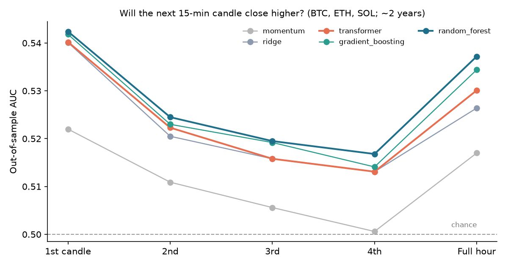
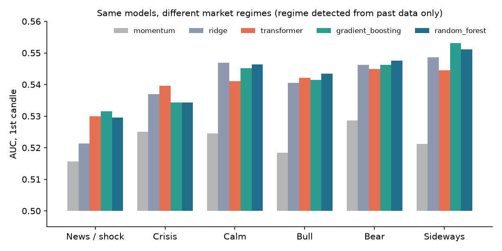

# updown

[](https://github.com/YAYUUUN/updown/actions/workflows/ci.yml)  [](LICENSE) [](https://github.com/YAYUUUN/updown/releases)

**Will the next candle close higher?** `updown` estimates that probability with 13 classical models and a transformer, using free public market data, and puts an honest out-of-sample track record next to every number.

Most "price prediction" projects report a nice backtest. This one is built the other way round: first an evaluator that is hard to fool (and is tested to catch its own mistakes), then the models. In liquid markets the usual answer is "no demonstrated edge", and the tool says so.

**Live demo: [yayuuun.github.io/updown](https://yayuuun.github.io/updown/).** Two of the models run in your browser on BTC, ETH and SOL, each probability next to that model's out-of-sample track record.

> Research and educational tool. **Not financial advice**, not a trading system. It does not place orders.

*Documentación en español: [README.es.md](README.es.md).*



## What it found

On BTC, ETH and SOL (Binance, 15-minute candles, about 2 years, ~210,000 rows, evaluated out of sample, no costs):

- **The next candle is slightly predictable, and the edge fades with distance.** Out-of-sample AUC is about 0.54 for the 1st candle, 0.52 for the 2nd and 0.51–0.52 for the 4th (0.50 is chance). Hit rate goes from ~53% to ~51%.
- **All models beat both naive baselines** ("always up" and one-line momentum) on every target, after Holm correction and in at least 4 of 6 walk-forward blocks.
- **Random forest and gradient boosting are best overall; the transformer ties ridge.** The transformer is the best model in the *crisis* regime.
- **Predictability depends on the market regime:** weakest right after news-like shocks (AUC ~0.53), highest in calm and sideways markets (~0.55).
- **On daily US equities (SPY since 1993) and hourly ETFs, nothing beats "always up".**



Full tables: [`estudios/resultados_velas_regimenes.md`](estudios/resultados_velas_regimenes.md), [`estudios/resultados_comparativa.md`](estudios/resultados_comparativa.md), [`estudios/resultados_transformer_15m.md`](estudios/resultados_transformer_15m.md). These were produced before the order-flow features and the fixed lasso seed were added; re-running the studies will move the numbers slightly.

### Being measured next

`python -m estudios.etapas_confianza` asks three new questions on the same crypto data and writes `estudios/resultados_etapas_confianza.md`:

1. **Does the model hit more when it is more confident?** An AUC of 0.54 is an average over all candles; sometimes the model says 50.5% and sometimes 58%. The study ranks out-of-sample predictions by their distance from 50% and measures the hit rate of the 100%, 50%, 20%, 10% and 5% most confident ones.
2. **Which market stages does a hidden Markov model find**, how often is it at least 90% sure, and does it agree with the rule-based regimes?
3. **Does specialising by stage help, or does it just cut the data into smaller pieces?** A per-stage model (the best submodel of each stage, chosen on validation) against the same procedure without stages, the best single model and both baselines.

No results are published for it yet: run it to get them (more than an hour on a 4-core laptop; `--objetivos vela_1` halves it).

## How it avoids fooling itself

| Safeguard | Why |
|---|---|
| Walk-forward with an expanding window and a purge of `horizon` bars | Every prediction comes from a model trained only on the past; the purge stops the last training target from peeking into the test block. |
| Only closed candles | The last candle a feed returns is usually still moving; using it leaks the future. |
| Brier score against "always up", not accuracy | If prices rise 55% of the time, saying "up" every time is already 55% accurate. |
| Holm-corrected AUC p-values | With 13 models, one of them looks "significant" at 5% by luck almost half the time. |
| Effective sample size n/h for overlapping targets | Consecutive 1-hour targets share 3 of their 4 candles; ignoring that makes p-values optimistic. |
| Consistency: beat the baseline in ≥ 2/3 of blocks | One lucky period is not a signal. |
| Synthetic audit (`updown auditoria`, run in CI) | On a random walk the verdict must be "no edge"; a planted signal must be found; an injected future value must make AUC jump. |
| Prediction log written before outcomes (`updown vivo`) | The only track record that cannot be tuned after the fact. |
| Confidence cut chosen from the probabilities only, plus a version with the cut fixed from the previous block | Choosing the cut by looking at hits would inflate the result; a cut computed from future probabilities is not available live. |
| Intervals clustered by day | Three assets at the same time and consecutive candles are not independent bets. |
| HMM fitted on the training block only, with *filtered* probabilities | Smoothed probabilities and the Viterbi path are recomputed with data that came later. |
| Per-stage submodels chosen on a purged inner validation, never on the test block | Picking the winner of each stage on the test period would be fitting the test. |
| Per-stage model compared with the same procedure without stages, counted as one more trial, paired test | Separates the effect of specialising from the effect of choosing a model. |

## Install

```bash
git clone https://github.com/YAYUUUN/updown && cd updown
python -m venv .venv && .venv/Scripts/activate        # Linux/macOS: source .venv/bin/activate
pip install -e ".[app,dev]"                             # add ,deep for the transformer (PyTorch)
python -m pytest -q
ruff check .
```

For a CUDA build of PyTorch, follow [pytorch.org](https://pytorch.org/get-started/locally/) (e.g. `--index-url https://download.pytorch.org/whl/cu128`).

## Use

Every command and option has an English and a Spanish name (`evaluate` = `evaluar`, `--interval` = `--intervalo`...):

```bash
updown audit                                                # check the evaluator on synthetic data
updown evaluate SPY --interval 1d                           # 13 models, walk-forward
updown evaluate BTCUSDT,ETHUSDT --source binance --interval 15m --horizon 4
updown evaluate SPY --models ridge,random_forest --folds 4  # only some models
python -m estudios.velas_regimenes                          # per-candle and per-regime study
python -m estudios.etapas_confianza                         # confidence curve, HMM stages, per-stage models
python -m estudios.graficos                                 # README charts from the results files
streamlit run app.py                                        # web app
```

`updown evaluate` also prints the hit rate by confidence of the best model. If a download fails, the CLI says why (unknown symbol, Binance unavailable in your country, Yahoo rate limits) and exits with code 2.

The **web app** shows which stage each market is in right now (rule-based label plus the HMM probabilities, as a description and not as a signal) and has three tabs:

- **Por vela**: with a regime selector, which model predicts each of the next four candles best in that regime.
- **Ranking por etapa**: with the same selector over rule-based or HMM stages, which model validation picked in each block, how every candidate did out of sample in that stage, whether both rankings agree, and whether the per-stage model beats the single one.
- **Confianza**: hit rate against the share of candles the model dares to predict, with its 95% interval.

## Web demo

[yayuuun.github.io/updown](https://yayuuun.github.io/updown/) is the static page in `web/`, served by GitHub Pages with no server behind it. Your browser downloads the last 1,000 15-minute candles of BTC, ETH and SOL from Binance, drops the one still open, computes the same features as `updown/features.py` (ported line by line to `web/js/features.js`) and runs `ridge` and `gradient_boosting`, which `updown/export.py` turns into plain coefficients and trees.

- `python -m estudios.web_modelos` downloads about two years of candles, evaluates both models with the same purged walk-forward and writes `web/data/models.json` and `web/data/metrics.json`. The Pages workflow reruns it every Monday.
- `python -m estudios.web_resultados` turns the tables in `estudios/resultados_*.md` into `web/data/results.json`, so no number on the page is typed by hand.
- `tests/test_web.py` runs the JavaScript with Node and checks that its features and probabilities match Python's.

To try it locally: `python -m http.server --directory web` and open http://localhost:8000.

## Models

Baselines: `siempre_sube` (training up-frequency) and `momentum` (P(up | last candle up/down)).

| Family | Models |
|---|---|
| Linear | `lineal` (logistic), `ridge`, `lasso`, `elastic_net`, `lda`, `svm_lineal` |
| Probabilistic / neighbours | `naive_bayes`, `knn` (6 fixed features) |
| Non-linear | `random_forest`, `extra_trees`, `gradient_boosting`, `red_neuronal` (MLP) |
| Ensemble | `ensemble` (mean of ridge, lasso, random forest, gradient boosting) |
| Deep | `transformer`: 2-layer encoder over the last 64 candles (return, range, body, relative volume and, on Binance, the aggressive-buy share) plus the tabular features; one network predicts all four candles and the full hour. |

Hyperparameters are fixed in advance; tuning them on results would be more trials to correct for. About 26 scale-free features (multi-horizon returns, volatility, RSI, MACD, Bollinger, ATR, range position, gap, relative volume, calendar, and a reference market such as SPY or BTC), so several assets can train a single model.

On Binance candles, four **order-flow** features are added: the share of the candle's volume that was aggressive buying (taker buys; 0.5 is balance), the same share over the last hour, whether that share is unusual against the last day, and whether the number of trades is unusual.

## Market stages

### Rule-based regimes

Every candle gets one label computed from past data only. News is not read; its footprint in price and volume is.

| Regime | Rule |
|---|---|
| News / shock | a move above 4σ or volume 3σ above normal in the last few candles |
| Crisis | volatility in the top 20% of its past year and price falling |
| Calm | volatility in the bottom 30% of its past year and no clear trend |
| Bull / Bear | 30-day trend and position versus the 30-day mean |
| Sideways | everything else |

A regime is detected once it has started, never before.

### Stages with probabilities (HMM)

A Gaussian hidden Markov model learns from the data a few hidden states (4 by default), each with its typical volatility and trend, and the probabilities of moving between them. Each candle is observed through the same two quantities the rules use, made scale-free: last-day volatility as a z-score against its past year, and the 30-day return divided by the volatility of that horizon. The result is not a label but probabilities, such as "75% calm, 20% bull, 5% crisis".

- In every walk-forward block the HMM is fitted on the training period only.
- Each candle gets its **filtered** probability, P(state | data up to that candle), never the smoothed one.
- States are named by fixed zones of their mean volatility and trend (crisis, volatile, calm, bull, bear, sideways); two states in the same zone share the name and their probabilities add up.
- A stage only counts when its probability is at least 90%; otherwise the candle is "uncertain" and the general model predicts it.

Implemented in numpy (`updown/hmm.py`): `hmmlearn` has no wheels for recent Pythons and its posteriors are smoothed.

### Per-stage submodels

For every model and every stage, a submodel is trained only on past candles of that stage; the general model (each model trained on all candles) competes too, and it takes over stages with too few candles. Inside each training block the last 20% (purged) is held out: candidates are trained on the earlier 80%, the one with the lowest Brier on that stage's validation candles wins the stage, and winners are retrained on the whole block. The test period never takes part in the choice. The transformer only competes as a general candidate (one per stage and block would take hours).

Out of sample, the per-stage model is compared with the same procedure without stages (the fair comparison), with every single model and the best one picked after the fact (which favours it), and with both baselines; it counts as one more trial in the Holm correction, and the Brier difference gets a paired test with day-clustered errors. Two rankings per stage, what validation picked and how each submodel did out of sample, show whether the choice is stable or the stage is too noisy to trust.

## Data

| Source | What | Depth |
|---|---|---|
| Yahoo Finance via [`yfinance`](https://github.com/ranaroussi/yfinance) | stocks, ETFs, indices, FX, crypto | 1m: 7 days · 5–30m: 60 days · 1h: 730 days · 1d: full history |
| Binance public REST API | crypto, real time | as far back as requested (paginated) |

Binance candles also bring the number of trades and the taker-buy volume (order flow). Downloads are cached in `~/.cache/updown` (or `$UPDOWN_CACHE`); Binance updates fetch only new candles, and a cache written by an older version (without those columns) is downloaded again in full instead of being mixed with new candles. `yfinance` is an unofficial client intended for personal and research use: check Yahoo's terms before anything else. Binance is not available in every country; `UPDOWN_BINANCE_URL=https://data-api.binance.vision/api/v3/klines` uses its market-data mirror where `api.binance.com` does not answer. No market data is shipped with this repository (the web demo ships trained model parameters and metrics, not candles).

## Limitations

- Statistically real is not economically useful: a 53% hit rate on 15-minute candles is small next to trading costs, which this study deliberately ignores.
- The large-cap stock universe in the comparison is today's large caps (survivorship bias).
- Two years of crypto data cover a limited set of market conditions; nothing here guarantees the next regime behaves the same.
- The HMM probability is the model's own belief, not a verified frequency: a hidden state has no ground truth. With smoothed inputs it is often close to 100%, so the 90% rule may filter little; the study reports the share of "uncertain" candles.
- Per-stage selection is noisy where a stage has few validation candles; the agreement between the validation and out-of-sample rankings says how far to trust it.

## Project layout

```
updown/       data.py · features.py · regimes.py · hmm.py · models.py · transformer.py
              evaluate.py · candles.py · stages.py · confidence.py · predict.py · audit.py
              export.py (models for the web) · __main__.py (CLI)
app.py        Streamlit app
web/          static demo for GitHub Pages: index.html, js/ (features, models, page), data/
estudios/     reproducible studies and their results
tests/        offline test suite (synthetic data, mocked API)
```

## License

MIT © Jiajun Wang
